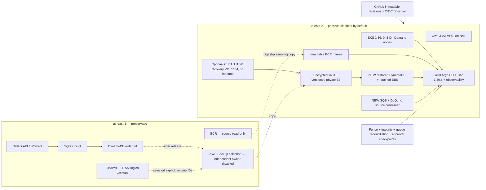

# V2-003 — DR ativo-passivo isolado

Estado: **implementação em Git; não provisionado nem certificado na AWS**.
Conta ainda em verificação, caso informado pelo titular `179418083900558`.
Nenhum apply, failover, mudança DNS ou experimento destrutivo foi executado.
O código, recursos e pipelines do Power Manager não são alterados.

## Região e arquitetura

Escolha: **us-east-2 (Ohio)**. `regional-evidence-2026-11-08.json` contém cotações
AWS Price List GetProducts com SKU, preço, timestamp, ofertas t3.large por AZ e
versões EKS em suporte padrão. `cost-comparison.json` compara a mesma arquitetura
com Oregon e São Paulo, discriminando componentes. Ohio empata com Oregon no
cenário cotado; a proximidade geográfica com o primário desempata a favor de Ohio.
Isto NÃO é uma medição de latência nem uma declaração de menor preço universal.
Residência: dados deixam us-east-1 para outra região dos EUA; não há requisito
informado de residência exclusiva no Brasil. São Paulo seria reavaliada se existir.

Pilot light: EKS control plane retained, zero worker capacity; databases and PVCs
are restored into NEW identifiers before application activation. No warm running
applications, NAT, ALB/NLB, EIP, DNS zone or route changes in the primary. A separate
DR VPC has public-egress workers, IMDSv2/hop=1 and no SSH ingress. Public worker
addresses cost money when enabled. This is a lab cost tradeoff; private nodes + NAT
or endpoints require a new price review. Control-plane public access requires
explicit operator CIDRs /24 or narrower; private access remains enabled.

DR ingress is **ClusterIP/internal**. Synthetic validation runs inside the standby
or through an authenticated operator tunnel. No public production traffic switch
is implemented in this phase. Public TLS/ACM, secondary LB and approved DNS change
are prerequisites to a future production failover, with additional costs. Existing
primary IPs/endpoints remain unchanged; a secondary region cannot inherit an EIP
or ALB/NLB address from us-east-1.

EKS 1.36 was returned in STANDARD_SUPPORT by all candidate APIs. The retrieved
stable Helm catalog offers Istio 1.30.8; the official Istio support matrix includes
Kubernetes 1.36 for that release (not 1.37). Pinned chart SHA256s are verified by
`render_platform.py`. Before AWS deployment, recheck support windows and resolve
compatible EKS add-on versions. The Terraform add-ons currently request the AWS
compatible default; a real deployment must record/pin the resolved versions and verify platform
container digests/scanning before activation. Chart digests do not freeze upstream
container tags.

## Owners and state isolation

- Infrastructure repository existing `dev` root owns ITSM/legacy Lambda and other
  components. Never clone/apply that whole root to a second region.
- `aws-eks-istio-lab/terraform/ephemeral` declares EKS/VPC/nodes; `persistent`
  declares the active `order_id` table, queues, ECR and Pod Identity. Its files do
  not declare a backend: actual live state ownership still needs verification in
  the authorized environment. No state import/migration is performed here.
- Existing infrastructure `orders_inventory.tf` seeds `INVENTORY#LAB` in that table
  and ignores subsequent application stock changes. Never run that seed against a
  recovered table or reset inventory during restore.
- New DR state: `aws-serverless-lab/dr/terraform.tfstate` in the existing backend.
  Backup-only source state: `aws-serverless-lab/dr-backup-source/terraform.tfstate`.
  Read-only OIDC bootstrap: `aws-serverless-lab/dr-bootstrap/terraform.tfstate`.
  All are separate from primary and Power Manager keys. Backend remains in
  us-east-1; an outage there blocks Terraform operations until an independently
  verified recovery of state/locking. Pre-position configuration/state recovery
  evidence off-region before declaring region-loss readiness. Do not concurrently
  create another writable copy of Terraform state.
- New backups select exactly the known orders table and explicit volume ARNs.
  No tag wildcard/all-account selection, source table import, PITR change, ECR
  registry replication configuration or global account setting is applied.
- Observer OIDC trust pins immutable GitHub owner/repository IDs, `main`, STS
  audience, and one-hour sessions. No absolute calendar trust expiry/static keys.
  It has no apply, power, queue-consume or secret-read permissions. Provisioning
  IAM is intentionally NOT an AdministratorAccess publisher. Generate/review a
  baseline from the actual approved plan and grant only the required scope before
  any deployment. EKS cluster-admin is confined to an explicitly provided DR
  operator role and ONLY the new cluster.

## Recovery strategy and known gaps

| Data/service | Implemented recovery path | Limitation / readiness gate |
|---|---|---|
| DynamoDB | hourly AWS Backup + destination vault; compiler restores NEW `cosmotech-dr-orders-restored` | Advanced DynamoDB backup/region copy opt-in must be verified. Source code has PITR disabled; no PITR or Global Table silently enabled. Restore protection/PITR and count/hash checks required before writers. |
| SQS / DLQ | separate encrypted queues; validated replay compiler preserving immutable v2 order IDs | No native cross-region replication. Current producer ACKs SQS send, no durable outbox. Queue loss has unbounded RPO until durable acceptance journal is integrated/replicated; promotion blocked when reconciliation cannot be proven. No source Receive/Delete/Purge. |
| EBS/PVC | explicit selected volume copies; encrypted gp3 restore compiler; Retain storage class | Snapshots are crash-consistent unless app coordinated. Multi-volume/database consistency requires logical dumps/quiescence. Source volumes never detached/deleted. |
| S3/application files | versioned encrypted destination, checksummed logical recovery bundle staged by authorized operator | No source bucket replication policy modified. Historical objects need explicit copy/manifest or S3 Batch Replication, not merely a new CRR rule. Terraform state/Power Manager buckets excluded. |
| ECR | destination immutable repos + digest-preserving skopeo copy of existing Orders images | Registry-wide replication belongs to source owner, not this DR state. Existing images not automatically replicated. Verify destination manifest digest/scanning; copy execution blocked until AWS release evidence. |
| Secrets/certificates | new regional secret metadata/recovery access scoped to `cosmotech/dr/itsm/*`; no values in Git/state | Secure provisioning/rotation by owner required. Do not copy AWS keys, MFA, Argo admin keys or primary credentials for convenience. ACM regional certificates need separate issuance for public ingress. |
| Argo / Istio / API / Worker | pinned platform render; local-only Argo project; immutable image refs; replicas=0; worker mode=pause | No HPA/canary/Ingress from primary. No second Argo controlling the first cluster. New endpoint/runtime validation and approved activation commit required. |
| Grafana/Prometheus | pinned chart, external admin secret, Retain volume, RTO/RPO dashboard and alerts | Restore Grafana DB/plugins/dashboards consistently, validate datasource region and credentials; no exporter falsely filling absent metrics with zero. |
| Kestra / GLPI | clean optional SSM recovery VM; isolated digest-pinned database restore Compose; apps opt-in profile | Never boot a copied primary VM with active schedules or mount primary Docker socket. Restore dumps/files, encryption key securely, disable automation/webhooks/mail and sanitize regional URLs before enabling apps. Sandbox network is internal-only. |
| Loki/Tempo | pinned isolated Loki/Tempo charts, retained storage, OTel trace/log exporters and Grafana datasources | Offline rendered only. Historical telemetry copy/restore, configuration/secrets and end-to-end queries remain unvalidated. |
| Zabbix | source backup runbooks and selected-volume restore | No destination Zabbix deployment included; separately validate config/DB/host integrations before claiming full lab DR. |

RTO objectives (provisional, not SLAs): Orders isolated recovery <=120 minutes;
ITSM <=240 minutes; observability <=120 minutes. Persisted data RPO objective <=60
minutes **plus actual backup/copy delay**. Hourly jobs can start up to 60 minutes
late and run up to 180 minutes; configured windows do not guarantee an hourly
recoverable point. Alert against latest COMPLETED destination copy, not schedule.
Current SQS acknowledged-but-not-journaled orders have **no bounded RPO**.
No AWS RTO/RPO has been measured; simulated timestamps and the prior Power Manager
cycle are not DR evidence.

## Price scenario (incremental to unchanged primary)

730 hours/month, 354 GB snapshots retained on each side, 100 GB S3, 1 GB DynamoDB
backup per side, 5 GB ECR, two secrets/two KMS keys, 5 GB logs ingested/stored,
10 GB/month cross-region transfer. Activated mode has three t3.large nodes,
414 GB gp3 restored/boot storage, three public worker IPv4s and 1 GB restored table.
No NAT/public LB/DNS/Global Table. Prices/units/SKUs and assumptions are versioned
in `cost-comparison.json`, including variable costs omitted from these scenario totals.

| Region | Passive/month | Activated internal DR/month |
|---|---:|---:|
| Ohio | US$117.05 | US$343.58 |
| Oregon | US$117.05 | US$343.58 |
| São Paulo | US$127.28 | US$495.86 |

Optional clean Ohio ITSM t3.large +20GB root +IPv4 adds US$65.99/month when running
(total activated scenario US$409.57). Taxes, API requests, backup churn/restore,
CPU surplus credits, Internet egress, additional retained boot volumes and public
routing are extra. These are scenario estimates, NOT live billing forecasts or
proof that 354 GB incremental backup storage will remain constant. No cost is
incurred by this Git-only implementation. Default financial ceiling stays zero;
an updated complete estimate and explicit existing financial limit are required.

## Sources

- https://aws.amazon.com/eks/pricing/
- https://istio.io/latest/docs/releases/supported-releases/
- https://docs.aws.amazon.com/amazondynamodb/latest/developerguide/CrossRegionAccountCopyAWS.html
- https://docs.aws.amazon.com/amazondynamodb/latest/developerguide/Point-in-time-recovery.html
- https://docs.aws.amazon.com/AmazonS3/latest/userguide/replication-how-setup.html
- https://docs.aws.amazon.com/AmazonECR/latest/userguide/replication.html
- https://aws.amazon.com/ecr/pricing/
- https://aws.amazon.com/kms/pricing/
